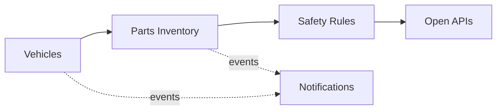

# Domain Model and Bounded Contexts

Ubiquitous language and context design (view VP-4). Domain-standard concepts are mapped
normatively in `../domain/domain-standards.md` (CR-5).

## Ubiquitous language (selected terms)

| Term | Meaning |
|---|---|
| **Vehicle** | A registered vehicle; its VIN is masked by construction |
| **Parts inventory** | The guarded available-units account of a plant warehouse |
| **Parts withdrawal** | One draw of parts against plant inventory |
| **Safety rule** | A decision rule for one vehicle system area, with coverage and defect envelopes |
| **Diagnostic score** | A transparent 0-100 anomaly score from vehicle signals |
| **Safety case verdict** | Findings/open-items vs coverage evidence for a vehicle program |

## Bounded contexts and invariants

### Vehicles — `vehicle-service`
Vehicle registry; the VIN is masked at registration and never kept in clear. Lifecycle: `REGISTERED` → transitions
activate, retire. Vehicle identifiers (VIN) are validated at registration and never stored or returned in clear — only a masked form is kept. All identifiers are synthetic.

### Parts Inventory — `parts-inventory-service`
Guarded parts availability per plant and the withdrawals against it. **Invariant (ADR-0004): the available parts inventory of a plant never goes negative — a withdrawal that exceeds availability is rejected (422) and records nothing, so production planning never runs on phantom stock.** Consumption records are
append-only evidence; a rejected operation records nothing.

### Safety Rules — `safety-rules-service`
Per-system-area safety envelopes (coverage, defect rate) with reasoned decisions. Only ACTIVE rules decide; evaluation order is by priority; every decision
is ALLOWED / DEGRADED / DENIED with the matched rule and a human-readable reason.

### Vehicle Models — `model-catalog-service`
Vehicle model catalogue: segments and capacities.

### Notifications — `notification-service`
Delivery trail for audit; recipients are never logged.

## Context map

